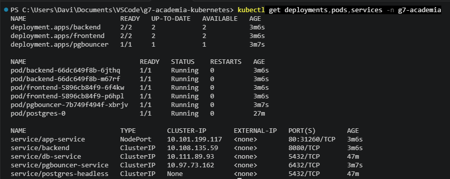
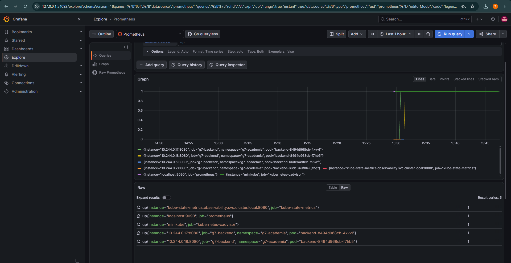
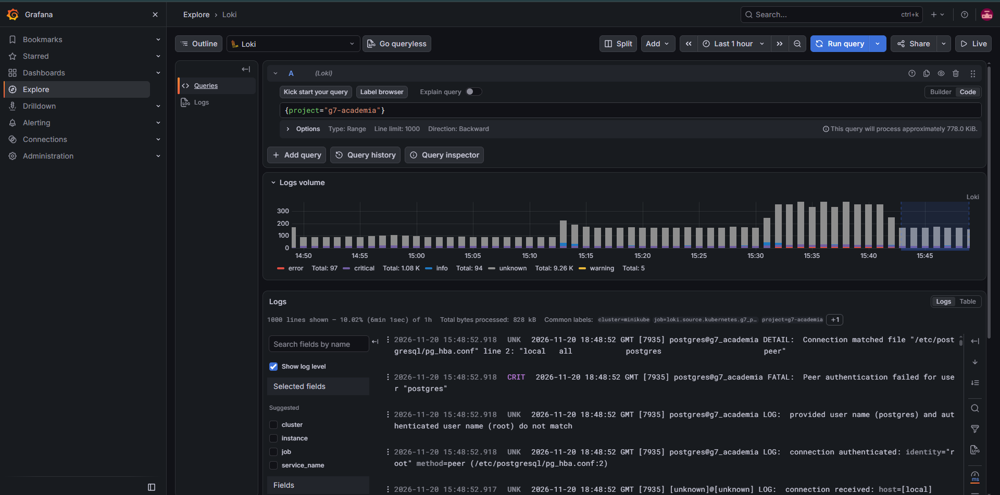
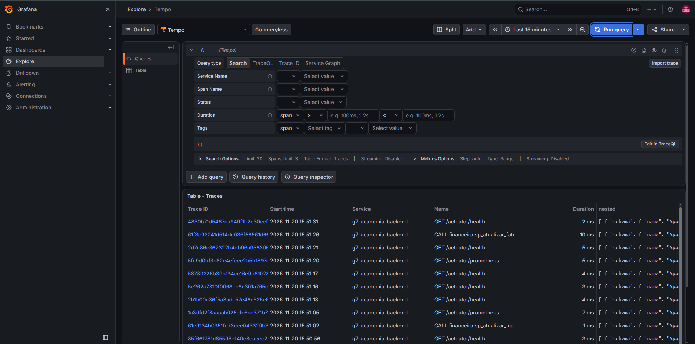

# G7 Academia — Projeto Kubernetes e Observabilidade

**Integrantes:** Davi Martins e Caio Vinicius  
**Projeto:** G7 Academia — sistema interno de controle de alunos, planos, matrículas, mensalidades e acessos.

Este repositório adapta o sistema original G7 Academia para execução em um cluster Kubernetes local com Minikube. A aplicação mantém o frontend Angular, a API Spring Boot, o PgBouncer e o PostgreSQL, e acrescenta uma stack de observabilidade com Prometheus, Loki, Grafana Alloy, Tempo, OpenTelemetry Collector e Grafana.

> **Escopo:** laboratório acadêmico local executado com Minikube e Docker Desktop. Os manifestos de observabilidade utilizam armazenamento local e não representam uma configuração de alta disponibilidade ou pronta para produção.

## 1. Arquitetura

### Aplicação

```text
Navegador
   |
   v
Service app-service (NodePort)
   |
   v
Frontend Angular + Nginx (2 réplicas)
   |
   v
Service backend (ClusterIP:8080)
   |
   v
Spring Boot (2 réplicas)
   |
   v
PgBouncer (ClusterIP:6432)
   |
   v
PostgreSQL 16 (StatefulSet + PVC de 2 GiB)
```

### Observabilidade

```text
Métricas: Spring Boot / Kubernetes -> Prometheus -> Grafana
Logs:     Pods do Kubernetes -> Grafana Alloy -> Loki -> Grafana
Traces:   Spring Boot (OTLP) -> OpenTelemetry Collector -> Tempo -> Grafana
```

## 2. Tecnologias utilizadas

| Camada | Tecnologia |
|---|---|
| Frontend | Angular 18, TypeScript e Nginx |
| Backend | Java 21, Spring Boot 3.3.5, Spring Security e JWT |
| Banco de dados | PostgreSQL 16 |
| Pool de conexões | PgBouncer |
| Contêineres | Docker Desktop |
| Orquestração local | Kubernetes com Minikube |
| Métricas | Prometheus e kube-state-metrics |
| Logs | Grafana Alloy e Loki |
| Traces | OpenTelemetry Spring Boot Starter, OpenTelemetry Collector e Tempo |
| Dashboards | Grafana |

## 3. Estrutura principal do repositório

```text
backend/                  API Spring Boot
frontend/                 SPA Angular e configuração Nginx
bd/                       Configuração e backup SQL do PostgreSQL
k8s/                      Manifestos Kubernetes da aplicação e do banco
  observability/           Manifestos da stack de observabilidade
scripts/k8s/              Scripts PowerShell das etapas
apresentacao/              Material da apresentação do projeto
docs/                     Documentação da arquitetura
evidencias/               Capturas de tela para avaliação
README.md                 Este documento
```

## 4. Pré-requisitos

- Windows 10/11.
- Docker Desktop instalado e em execução.
- Minikube.
- `kubectl`.
- GitHub Desktop.
- Conexão com a internet para baixar imagens e dependências na primeira compilação.

Instalação pelo WinGet, quando necessário:

```powershell
winget install Kubernetes.minikube
winget install -e --id Kubernetes.kubectl
```

Neste ambiente, o Minikube foi instalado em `C:\Program Files\Kubernetes\Minikube`. Caso o PowerShell não reconheça o comando `minikube`, adicione o diretório ao PATH da sessão:

```powershell
$env:Path = "C:\Program Files\Kubernetes\Minikube;$env:Path"
minikube version
```

Alternativamente, invoque o executável pelo caminho completo:

```powershell
& 'C:\Program Files\Kubernetes\Minikube\minikube.exe' version
```

## 5. Subir o cluster Minikube

Abra o Docker Desktop e aguarde sua inicialização. Na raiz do repositório, execute:

```powershell
$env:Path = "C:\Program Files\Kubernetes\Minikube;$env:Path"
minikube start --driver=docker
kubectl wait --for=condition=Ready node/minikube --timeout=180s
kubectl get nodes
```

Preparar o namespace e os recursos iniciais:

```powershell
Set-ExecutionPolicy -Scope Process -ExecutionPolicy Bypass
.\scripts\k8s\etapa1-preparar.ps1
```

Resultado esperado: nó `minikube` com estado `Ready` e namespace `g7-academia` ativo.

## 6. Implantar o PostgreSQL

Na raiz do repositório, execute:

```powershell
.\scripts\k8s\etapa2-postgres.ps1
```

O banco utiliza PostgreSQL 16, StatefulSet, PVC persistente de 2 GiB e o Service interno `db-service` na porta `5432`. O backup inicial contém os schemas, tabelas, rotinas e dados de demonstração do G7 Academia.

Na implantação utilizada para esta atividade, o PostgreSQL ficou `Running 1/1`, o PVC ficou `Bound`, a consulta retornou **5 alunos** e foram identificadas as tabelas `alunos`, `matriculas`, `operadores`, `planos` e `registros_acesso` no schema `app`.

A inicialização do PostgreSQL deve preservar o `ENTRYPOINT` original da imagem oficial. Por isso, o manifesto `k8s/12-postgres-statefulset.yaml` passa as opções adicionais por `args`, e não por `command`. Se for necessário recuperar a implantação, utilize o script de recuperação da Etapa 2 disponível em `scripts/k8s/etapa2-recuperar-postgres.ps1` e mantenha o PVC existente.

> **Importante:** não exclua `postgres-data-postgres-0` durante uma recuperação. Esse PVC contém os dados persistentes do banco.

Para conferir o banco e os dados:

```powershell
kubectl get pods,pvc,services -n g7-academia
kubectl exec postgres-0 -n g7-academia -- su-exec postgres psql -X -U postgres -d g7_academia -c "SELECT COUNT(*) AS total_alunos FROM app.alunos;"
kubectl exec postgres-0 -n g7-academia -- su-exec postgres psql -X -U postgres -d g7_academia -c "SELECT table_name FROM information_schema.tables WHERE table_schema = 'app' AND table_type = 'BASE TABLE' ORDER BY table_name;"
```

## 7. Implantar a aplicação replicada

Execute:

```powershell
.\scripts\k8s\etapa3-aplicacao.ps1
```

O script constrói as imagens do projeto e implanta PgBouncer, backend e frontend. A configuração utilizada prevê:

- Backend Spring Boot: **2 réplicas**.
- Frontend Angular/Nginx: **2 réplicas**.
- PgBouncer: **1 réplica**.
- PostgreSQL: **1 StatefulSet** com volume persistente.

Conferir os recursos:

```powershell
kubectl get deployments,pods,services -n g7-academia
```

Para abrir a aplicação:

```powershell
minikube service app-service -n g7-academia --url
```

Se o comando `minikube` não estiver no PATH, utilize:

```powershell
& 'C:\Program Files\Kubernetes\Minikube\minikube.exe' service app-service -n g7-academia --url
```

Mantenha o terminal desse comando aberto enquanto utilizar a URL apresentada.

## 8. Instalar a stack de observabilidade

Execute:

```powershell
.\scripts\k8s\etapa4-observabilidade.ps1
```

O script cria o namespace `observability`, solicita uma senha para o usuário `admin` do Grafana, aplica os manifestos e recompila o backend com instrumentação de métricas e traces.

### Versão do OpenTelemetry Collector

Durante a implantação, a tag `otel/opentelemetry-collector-contrib:0.165.1` retornou `NotFound` no registry. O manifesto `k8s/observability/30-otel-collector.yaml` foi ajustado para utilizar `otel/opentelemetry-collector-contrib:0.165.0`. A imagem foi baixada para o Minikube e o Collector iniciou com a mensagem `Everything is ready. Begin running and processing data.`

Caso seja necessário repetir somente a aplicação do Collector após atualizar a imagem no manifesto:

```powershell
$image = "otel/opentelemetry-collector-contrib:0.165.0"
& 'C:\Program Files\Kubernetes\Minikube\minikube.exe' image pull $image
kubectl apply -f .\k8s\observability\30-otel-collector.yaml
kubectl rollout status deployment/otel-collector -n observability --timeout=120s
```

### Componentes implantados

| Componente | Função |
|---|---|
| Prometheus | Coleta métricas da aplicação e do cluster |
| kube-state-metrics | Expõe o estado dos objetos Kubernetes |
| Loki | Armazena logs dos Pods |
| Grafana Alloy | Descobre e encaminha logs do Kubernetes ao Loki |
| Tempo | Armazena traces distribuídos |
| OpenTelemetry Collector | Recebe OTLP e exporta traces para o Tempo |
| Grafana | Centraliza fontes de dados e dashboards |

Conferir os recursos:

```powershell
kubectl get deployments,pods,services,pvc -n observability
kubectl get deployments,pods -n g7-academia
```

Abrir o Grafana:

```powershell
minikube service grafana -n observability --url
```

Se necessário, utilize o caminho completo do Minikube:

```powershell
& 'C:\Program Files\Kubernetes\Minikube\minikube.exe' service grafana -n observability --url
```

Entre com o usuário `admin` e a senha definida durante a instalação. A senha é armazenada em um Secret do Kubernetes e não deve ser incluída nos arquivos versionados.

## 9. Consultas úteis no Grafana

### Prometheus — métricas

No Grafana, abra **Explore → Prometheus**, selecione o modo **Code**, execute a consulta e clique em **Run query**:

```promql
up
```

Estado dos Pods do namespace da aplicação:

```promql
kube_pod_status_ready{namespace="g7-academia",condition="true"}
```

Uso de CPU por Pod:

```promql
sum by (pod) (rate(container_cpu_usage_seconds_total{namespace="g7-academia",container!="",image!=""}[5m]))
```

### Loki — logs

No Grafana, abra **Explore → Loki** e execute:

```logql
{project="g7-academia"}
```

### Tempo — traces

No Grafana, abra **Explore → Tempo → Search**, selecione o intervalo de tempo desejado e pesquise o serviço `g7-academia-backend`. O backend envia traces via OTLP gRPC ao serviço `otel-collector.observability:4317`, que encaminha os dados ao Tempo.

## 10. Evidências da atividade

As capturas de tela estão organizadas na pasta `evidencias/` e documentam os principais resultados da implantação.

### 10.1 Pods, Deployments e Services

Comprova os recursos Kubernetes e as duas réplicas do backend e do frontend.



### 10.2 Aplicação G7 Academia no navegador

Captura da aplicação executada por meio do Service `app-service` do Minikube.


### 10.3 Prometheus — métricas

Captura do Grafana Explore com consulta PromQL `up`.



### 10.4 Loki — logs

Captura do Grafana Explore com consulta LogQL `{project="g7-academia"}` e registros dos Pods do projeto.



### 10.5 Tempo — traces

Captura do Grafana Explore com os traces distribuídos do serviço backend.



## 11. Segurança e versionamento

- Não versionar `.env`, tokens JWT, senhas do banco ou senha administrativa do Grafana.
- Manter `.env` ignorado pelo `.gitignore`.
- O PostgreSQL não é publicado externamente; o acesso é feito pelo Service interno `db-service`.
- O login do G7 Academia utiliza JWT e perfis de acesso.
- Os manifestos e scripts devem ser versionados; os dados físicos dos PVCs não devem ser adicionados ao Git.
- As credenciais utilizadas localmente devem ser mantidas em Secrets do Kubernetes ou em arquivos locais ignorados pelo Git.

## 12. Commits por etapa

Sugestão de histórico de commits para organizar a implementação:

```text
chore: importar projeto inicial G7 Academia
infra: preparar ambiente Kubernetes
feat(k8s): implantar PostgreSQL com volume persistente
feat(k8s): implantar aplicação replicada
feat(observability): configurar Prometheus Loki Tempo OpenTelemetry e Grafana
docs: finalizar documentação e evidências da atividade
```

## 13. Integrantes

- **Davi Martins**
- **Caio Vinicius**

---

**Projeto acadêmico — G7 Academia | Kubernetes e Observabilidade**
